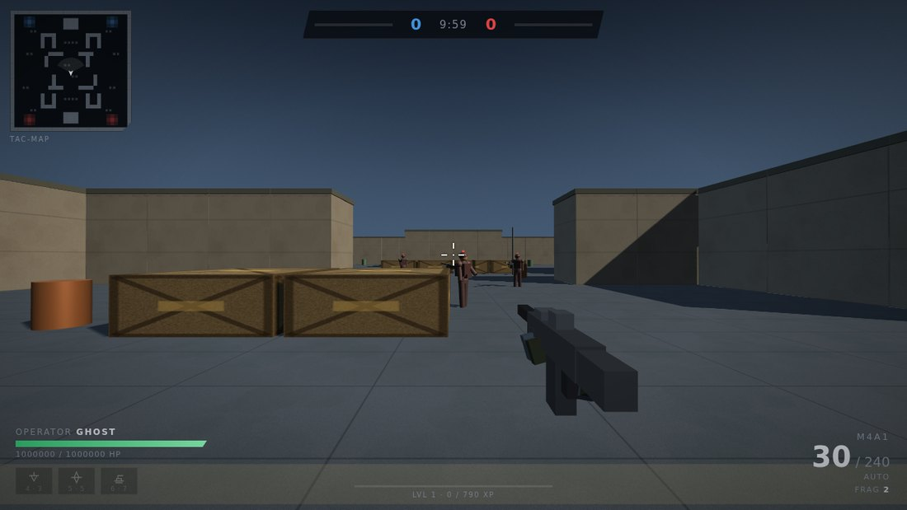
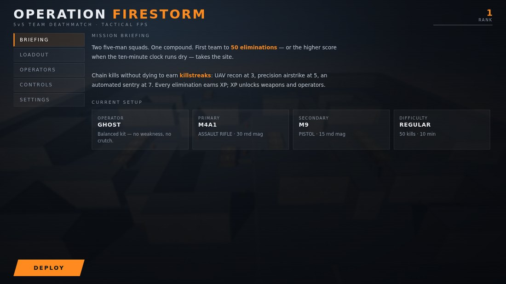
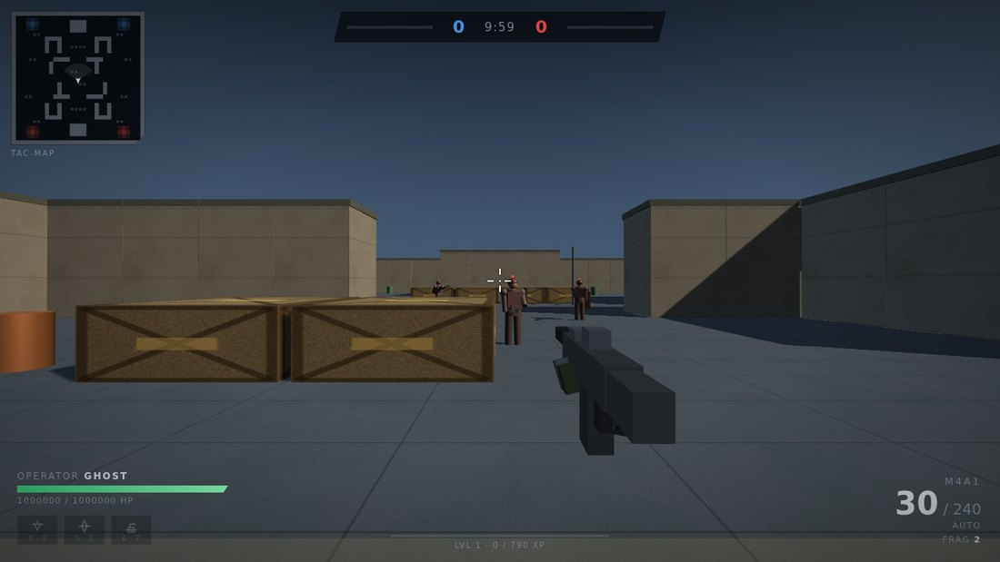
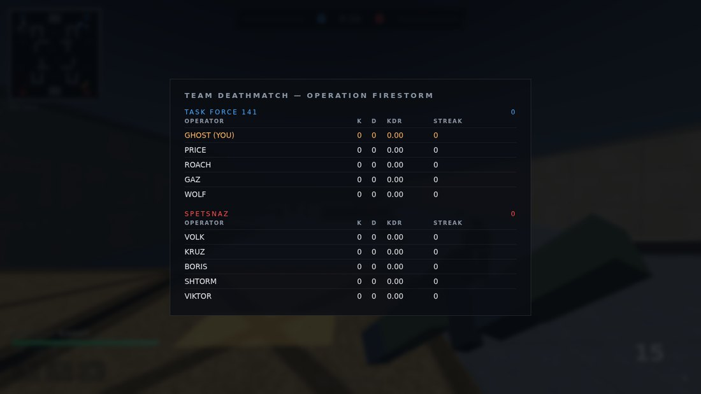

# Operation Firestorm

A 5v5 team-deathmatch FPS that runs in a browser tab. One HTML file, no install, no
build step required to play, no network needed after you've got the file.

**▶ [Play it here](https://dharoutounian.github.io/vigilant-fishstick/)**



---

## What it is

You and four AI teammates against five enemy bots on a symmetrical compound. First
team to 50 eliminations — or the higher score when the ten-minute clock runs out —
takes the site. Chain kills without dying to earn killstreaks. Kills earn XP, XP
unlocks weapons and operators.

Everything is procedural: the map, the textures, the weapon models, the soldiers, and
every sound effect are generated in JavaScript at load time. There is not a single
image or audio asset in this repository.

## Features

**Gunplay** — eight weapons across assault rifle, SMG, battle rifle, shotgun, sniper,
LMG and two sidearms. Each has its own damage, fire rate, magazine, reload time,
recoil pattern, spread cone, ADS time and damage falloff curve. Hitscan with real
raycasts, a 2.6× headshot multiplier and 0.82× on limbs. Frag grenades with bounce
physics, and a knife.

**Bots** — A* pathfinding over the map grid, line-of-sight raycasts, a vision cone
that widens up close, strafing engagement at a per-weapon ideal range, burst fire with
reaction delay, and grenades. Four difficulty tiers from Recruit to Veteran, each
tuning reaction time, accuracy, damage, rate of fire and burst length. Enemy bots earn
their own UAVs and airstrikes.

**Killstreaks** — UAV recon at 3 kills, a designated precision airstrike at 5, an
automated sentry gun at 7.

**Operators** — six unlockable characters that meaningfully change how you play:

| Operator | Unlock | Perk |
|---|---|---|
| Ghost | Level 1 | Balanced kit |
| Reaper | Level 2 | +30 max health, slightly slower |
| Viper | Level 3 | +14% movement, 25% faster ADS |
| Havoc | Level 5 | +16% damage, slower reloads |
| Nomad | Level 7 | 38% faster reloads, +50% reserve ammo |
| Spectre | Level 10 | Enemies take far longer to spot you |

**HUD** — rotating tac-map with UAV reveals and gunfire pings, killfeed, hitmarkers,
directional damage indicators, dynamic crosshair that opens with your spread, live
scoreboard, and an XP bar.



## Controls

| Input | Action |
|---|---|
| `W` `A` `S` `D` | Move |
| Mouse | Look — click once to capture the cursor for full 360° aim |
| `↑` `↓` `←` `→` | Aim (works with or without mouse capture) |
| `LMB` / `Enter` | Fire |
| `RMB` / `E` | Aim down sights |
| `Shift` | Sprint |
| `Space` | Jump |
| `Ctrl` / `C` | Crouch |
| `R` | Reload |
| `1` `2` `Q` / wheel | Primary / secondary / quick swap |
| `G` | Frag grenade |
| `F` | Melee |
| `4` `5` `6` | UAV / airstrike / sentry gun |
| `Tab` | Scoreboard (hold) |
| `Esc` | Pause |

Mouse capture is an optional upgrade, never a requirement. If the page can't capture
your cursor — which happens inside embedded viewers and sandboxed iframes — the game
drops into free-aim: moving the mouse turns the view, the screen edges keep turning
you, and the arrow keys aim precisely. Every other control works identically in both
modes.



## Running it

Download [`index.html`](index.html) and open it in any modern browser. That's the whole
install. It's a single self-contained file with three.js inlined, so it works with no
network connection at all.

If it runs poorly, open Settings and drop **Graphics quality** — the presets control
pixel ratio, shadow resolution, shadow filtering, anisotropy and draw distance. Pause
(`Esc`) shows your current frame rate.

## How it's built

`index.html` is generated, not hand-edited. The source lives in [`src/`](src/) as
ordered fragments that are concatenated into one file:

| File | Contents |
|---|---|
| `00_head.html` | HUD markup and all CSS |
| `10_core.js` | Tuning constants, difficulty table, procedural audio synthesis |
| `20_world.js` | Renderer, quality presets, map generation, collision, A* pathfinding |
| `30_weapons.js` | Weapon and operator tables, viewmodel, hitscan, particle effects |
| `40_player.js` | Input, movement, firing, grenades, spawning |
| `50_bots.js` | Soldier models, bot AI, damage resolution, sentry guns |
| `60_streaks.js` | Killstreaks and progression |
| `70_hud.js` | HUD, minimap, killfeed, scoreboard |
| `80_menu.js` | Menus, loadout, settings |
| `90_main.js` | Match flow and the fixed-timestep game loop |

To rebuild after editing anything in `src/`:

```bash
python3 src/build.py
```

That inlines three.js from `node_modules` and writes `index.html`. Install the
dependency first with `npm install`.

The world runs on a fixed 1/60 s timestep with a substep cap, so the simulation
advances at the same rate regardless of frame rate — a slow machine drops frames
instead of playing in slow motion, and the physics behave identically at 30 fps and
144 fps.

## Tests

The game is verified by driving a real browser with Playwright — real clicks, real key
events, real mouse movement.

```bash
npm install
npx playwright install chromium
npm test                 # controls, both with and without mouse capture
npm run test:systems     # weapon accuracy, explosives, killstreaks, pathfinding
npm run test:match       # a full simulated match
```

`tests/controls.test.js` runs twice: once normally, and once with
`requestPointerLock` stubbed to always fail, to prove the game stays playable when the
browser refuses to capture the cursor.

`tests/systems.test.js` pins a target at a known distance and fires measured volleys to
assert hit rates (100% at 28 m aimed), the headshot multiplier, per-weapon damage,
melee, grenade and airstrike damage, sentry acquisition, and that bots path around the
map without clipping through walls or leaving the arena.



## Notes

Progress (rank, unlocks) is held in memory for the page session and resets on reload —
the game deliberately uses no browser storage.

## Credits

Built with [three.js](https://threejs.org) (r128, MIT), which is inlined into
`index.html`. Everything else — engine, AI, art, audio — is original and MIT licensed;
see [LICENSE](LICENSE).
