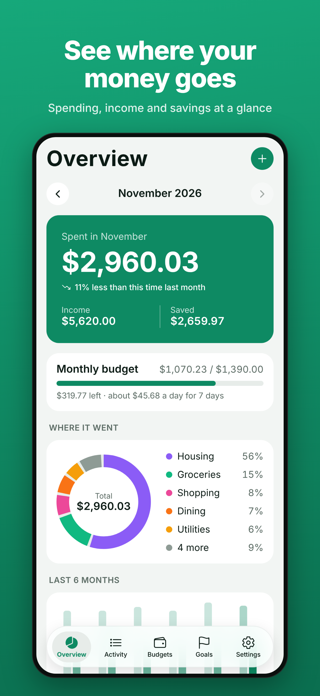
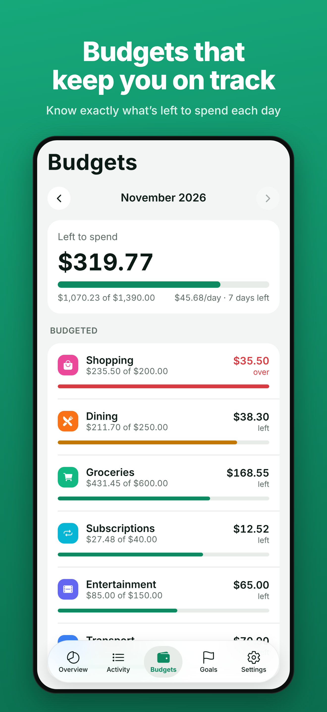
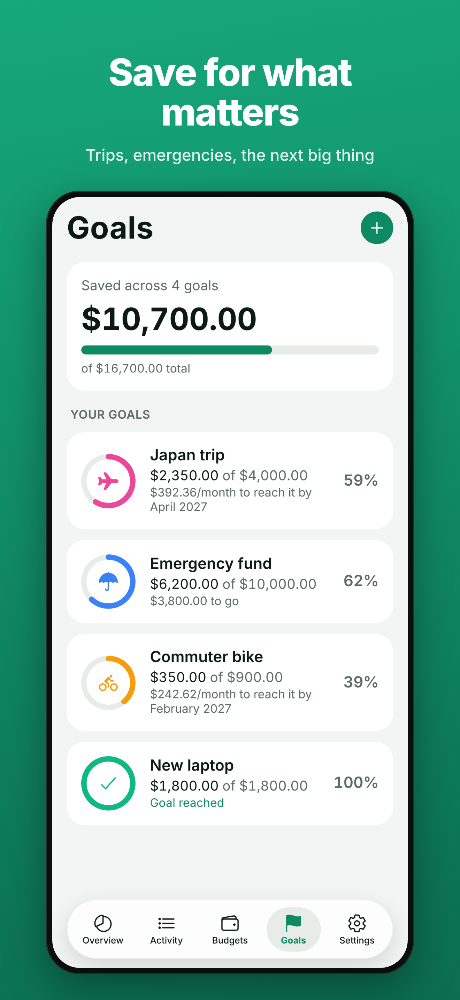
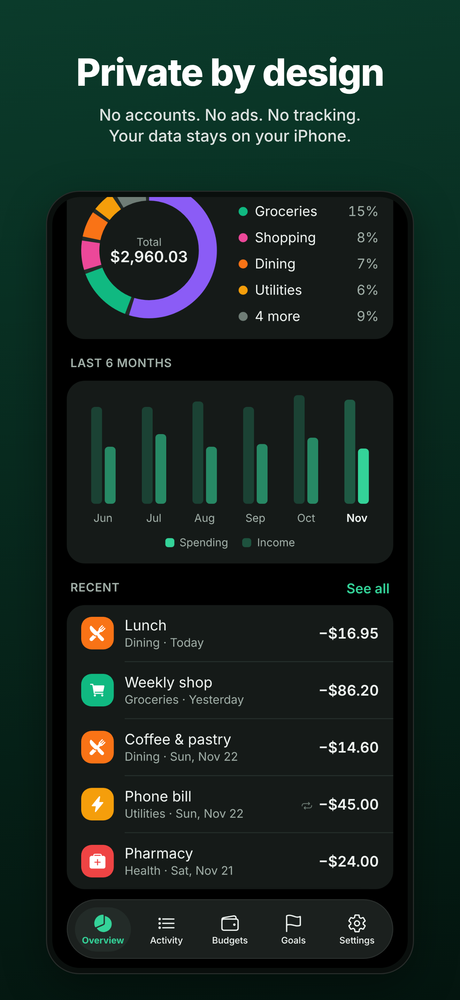

# Coinleaf

A private money manager for iPhone: track spending and income, set monthly
budgets, and save toward goals. No account, no bank login, no ads, no tracking.
Everything stays on the device.

<p>
  
  
  
  
</p>

Built with [Expo](https://expo.dev) (SDK 58, React Native 0.88). It can be built
and submitted to the App Store from the cloud with EAS, so you don't need a Mac.

## Features

- **Overview**: the month's spending, income and savings, a category breakdown, a
  six-month trend, and how this month compares with the same point last month.
- **Activity**: every transaction grouped by day, with filters and search across
  notes, categories and amounts.
- **Budgets**: monthly limits per category, what's left, a per-day allowance,
  amber at 80% and red when over, and suggested limits based on past spending.
- **Goals**: savings targets with an optional date, the monthly amount needed,
  deposits and withdrawals with history.
- **Repeating transactions**: weekly, every 2 weeks, monthly or yearly. They're
  added on their dates even if the app wasn't opened, and missed days are caught
  up. A monthly repeat on the 31st lands on the last day of shorter months. Repeats
  can be paused, edited or stopped.
- **Categories**: 16 defaults, plus your own with custom icons and colors.
  Deleting a category that has transactions hides it rather than rewriting history.
- **Privacy**: optional Face ID / Touch ID App Lock, CSV export, and Erase All Data.
- 45+ currencies, Dark Mode, and VoiceOver labels on controls.

## Publishing to the App Store

You need:

- An **Apple Developer Program** membership ($99/year) at
  [developer.apple.com/programs](https://developer.apple.com/programs/).
  Enrollment can take a day or two to be approved.
- A free **Expo account** at [expo.dev/signup](https://expo.dev/signup).
- **Node.js 20 or newer** on any computer (Windows, macOS or Linux).

### 1. Check the name and bundle ID

In `app.json`:

- `expo.name` is the name under the icon: **Coinleaf**.
- `expo.ios.bundleIdentifier` is the app's permanent ID:
  **`com.dharoutounian.coinleaf`**. It can't be changed after the first upload,
  so change it now if you want something different.

The App Store name must be unique. If App Store Connect says "Coinleaf" is taken,
choose another name there, and update `expo.name` and the strings that mention
Coinleaf if you want them to match.

### 2. Install and log in

```bash
cd coinleaf
```

```bash
npm install
```

```bash
npx eas-cli@latest login
```

```bash
npx eas-cli@latest init
```

`init` creates the project on your Expo account and adds its ID to `app.json`.
Commit that change.

### 3. Build for the App Store

```bash
npx eas-cli@latest build --platform ios --profile production
```

EAS asks you to sign in with your Apple ID, then creates the signing certificate
and provisioning profile for you (answer **yes** to the prompts). The build runs
on Expo's Macs and takes about 15–30 minutes. Build numbers go up automatically on
each build.

### 4. Upload it

```bash
npx eas-cli@latest submit --platform ios --latest
```

This uploads the build to App Store Connect, creating the app record there if it
doesn't exist yet. Apple then processes the build for 10–30 minutes.

### 5. Test it on your iPhone (strongly recommended)

In [App Store Connect](https://appstoreconnect.apple.com), open your app, then
**TestFlight**, and add yourself as an internal tester. Install the **TestFlight**
app on your iPhone and you'll get the build. Run through the checklist below.

### 6. Fill in the listing and submit

Everything to paste is in [`store/listing.md`](store/listing.md): name, subtitle,
description, keywords, URLs, the App Privacy answer (**Data Not Collected**), age
rating, and notes for the reviewer. Upload the six images from
[`store/screenshots/`](store/screenshots/) to the **6.9" Display** slot.

Then select the build under **Build**, and click **Add for Review** and **Submit**.
Review usually takes a day or two.

**Before submitting**, make sure the privacy policy and support pages are live.
They're in [`site/`](site/) and are published by this repository's GitHub Pages
workflow once this branch is merged into `main`:

- https://dharoutounian.github.io/vigilant-fishstick/coinleaf/site/privacy.html
- https://dharoutounian.github.io/vigilant-fishstick/coinleaf/site/support.html

If you host them somewhere else, update the URLs in
[`src/constants/links.ts`](src/constants/links.ts) and in the listing.

### Releasing an update

Bump `expo.version` in `app.json` (for example to `1.0.1`), then repeat steps 3, 4
and 6.

## On-device checklist

These use iOS features the automated tests can't reach, so check them in TestFlight:

- [ ] The icon looks right on the home screen, including in dark and tinted modes.
- [ ] The tab bar shows the five tabs with their icons and minimizes when you scroll.
- [ ] The amount field opens the number pad, and Save works after typing an amount.
- [ ] **Settings › App Lock**: Face ID asks for permission once, then locks the app
      on launch and after more than 30 seconds in the background.
- [ ] **Settings › Export** opens the share sheet with a `.csv` file that opens in
      Numbers or Excel.
- [ ] **Privacy policy** and **Help & support** open the web pages.
- [ ] Add a transaction, force-quit the app, reopen it, and the transaction is still there.
- [ ] Dark Mode and larger text sizes (Settings › Display & Brightness › Text Size)
      look right.

## Development

```bash
npm install
```

```bash
npm run web
```

`npm run web` runs the app in a browser. To run it on your iPhone during
development, install **Expo Go** and run `npm start`, then scan the QR code. Expo
Go doesn't include App Lock's Face ID permission, so test that in a TestFlight build.

### Tests

```bash
npm test
```

```bash
npm run typecheck && npm run lint
```

```bash
npm run export:web && npm run e2e
```

- `npm test` runs 63 unit tests of the money maths, dates, repeating
  transactions, budgets, goals, saving and loading, and CSV export.
- `npm run e2e` drives the web build in a real browser through 18 checks: adding,
  editing and deleting transactions, budgets, goals, categories, currency, data
  surviving a reload, a repeating paycheck appearing a month later, and Erase All.

### Regenerating images

```bash
node scripts/make-icons.js
```

```bash
npm run export:web && node scripts/screenshots.js
```

`make-icons.js` redraws the app icon (including the iOS 26 layered icon in
`assets/coinleaf.icon`), splash and Android icons from one SVG. `screenshots.js`
redraws the App Store screenshots from sample data.

## How it works

| Path | What's there |
|---|---|
| `src/app/` | Screens. `(tabs)/` holds the five tabs; the other files are editors shown as sheets. |
| `src/components/` | Shared UI: the tab bar, charts, calendar, amount field, and App Lock. |
| `src/lib/types.ts` | The data model. |
| `src/lib/reducer.ts` | Every change to the data goes through this reducer. |
| `src/lib/selectors.ts` | Totals, budgets, groupings and goal progress. |
| `src/lib/recurring.ts` | Turns repeating rules into transactions. |
| `src/lib/persist.ts` | Saving and loading, tolerant of damaged data. |
| `src/lib/store.tsx` | The React provider that loads, saves and catches up repeats. |

Some design decisions:

- **Money is stored as whole cents** and dates as `YYYY-MM-DD` local days, so totals
  never drift and time zones never move a transaction to another day.
- **Repeats are computed from their start date**, never from the previous
  occurrence, and each generated transaction has a deterministic ID. Catching up
  is therefore idempotent: running it twice never duplicates, and a deleted
  occurrence never comes back.
- **Saving waits for loading.** Nothing is written until saved data has been read,
  so a slow start can't overwrite real data with an empty state. Unreadable data is
  kept aside instead of being discarded.
- **Native where it counts**: the system tab bar (Liquid Glass on iOS 26), sheets,
  haptics, share sheet and Face ID.

Data is stored with AsyncStorage on the device and is included in iCloud and
computer backups. If you add anything that sends data off the device (analytics,
crash reporting, sync, ads), update `site/privacy.html` and the App Privacy answer
in App Store Connect first.
