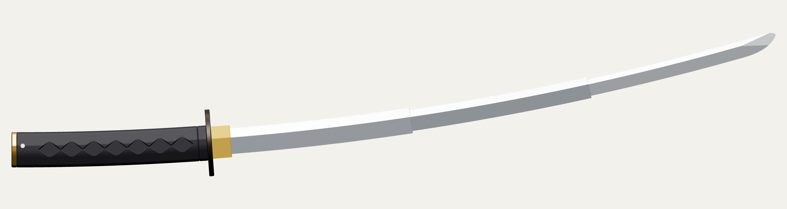
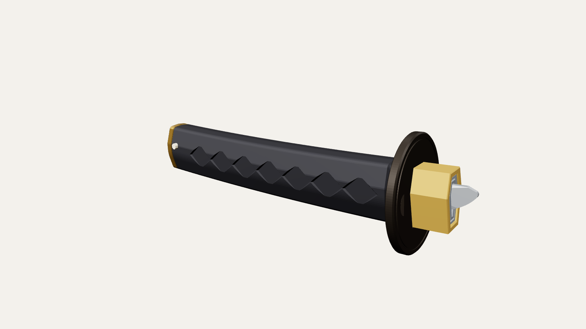
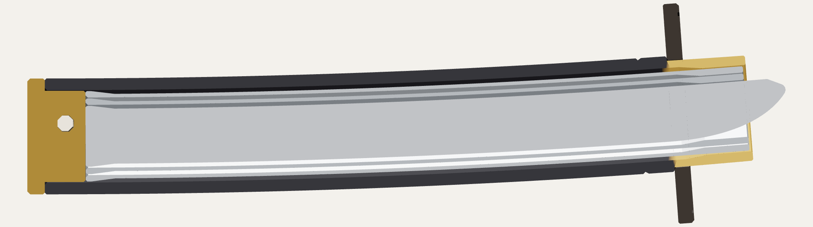
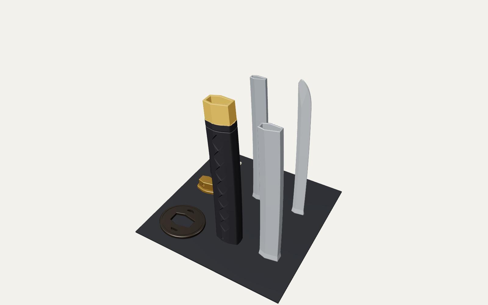

# Collapsible Katana

A 3D-printable katana that hides in its own handle. Flick it and the blade shoots out to
about 88 cm and locks. Push the tip back in and it collapses to 26 cm. Sized for the
**Anycubic Kobra S1** (250 × 250 × 250 mm). No supports, no screws, no glue required.





## How it works

The blade is three hollow sections that nest inside each other and inside the handle.
They all follow the same gentle curve, so the blade still looks like a katana when it's
open. The bottom of each section has a small flared collar, and the top of the part
around it narrows into a tapered mouth.

- **Flick it:** the sections slide out until each collar jams into the mouth above it.
  The taper wedges it tight, so the blade stays out.
- **It can't fly apart:** a collar is bigger than the mouth it slides through, so a
  section can't come out the top no matter how hard you flick.
- **Push it in:** pressing on the tip pops each wedge loose and the sections slide back
  into the handle.



*Cut in half, collapsed. Black: handle. Grey: the three blade sections nested inside.
Gold at the left: the pommel cap and its pin.*

## Files

All files are in [`stl/`](stl/) and are already oriented the way they should print, so
**don't rotate them**.

| File | What it is |
|---|---|
| `handle.stl` | Grip (tsuka) and gold collar (habaki), in one piece |
| `blade_1_base.stl` | Biggest blade section, nearest the guard |
| `blade_2_middle.stl` | Middle blade section |
| `blade_3_tip.stl` | Tip section, solid, with the curved kissaki point |
| `tsuba_guard.stl` | The round guard |
| `pommel_cap.stl` | End cap that closes the bottom of the handle |
| `pin.stl` | Tapered peg that locks the end cap in |
| `keeper_cap_optional.stl` | Optional cap that stops the blade sliding out while you carry it |
| `fit_test_outer.stl`, `fit_test_inner.stl` | A quick test print of one joint. **Print these first.** |

Everything fits on one plate:



## Print settings (Anycubic Slicer Next)

| Setting | Value |
|---|---|
| Material | PLA (silver for the blade, black for the handle looks great) |
| Layer height | 0.2 mm |
| Wall loops | **3** (blade walls are exactly 3 lines thick, so they come out solid) |
| Infill | 15% gyroid |
| Supports | **Off**, nothing needs them |
| Brim | **On**, 5 mm, for the four tall parts |
| Elephant foot compensation | 0.1–0.15 mm |
| Seam position | Aligned |

Tips:

- The tall parts are up to 244 mm, just under the S1's 250 mm height limit.
- Print the four tall parts together on one plate. Each layer gets more time to cool,
  and the thin tip section prints cleaner.
- The full set uses roughly 200 g of filament.

## 1. Print the fit test first

Print `fit_test_outer.stl` and `fit_test_inner.stl` with the **same settings** you'll use
for the sword. Push the plain end of the inner piece into the wide bottom of the outer
piece, then slide it up until the collar stops at the narrow top.

- **It slides smoothly, stops with a click, stays put when you shake it gently, and
  pushes back with your thumb.** Perfect, print the sword.
- **Too tight to slide:** in the slicer set *X-Y hole compensation* to **+0.05 mm**
  (try +0.1 if it's still tight) and print the test again.
- **Loose, or it won't stay out:** set *X-Y hole compensation* to **−0.05 mm**.

Use whatever value worked for every part of the sword.

## 2. Assemble

1. **Guard:** slide the tsuba over the gold collar, decorated side toward the blade,
   down to the shoulder on the handle. It should be snug; add a drop of super glue if it
   wobbles.
2. **Blade:** the sections go in **from the bottom**, pointy end first:
   - Push the tip section into the *bottom* of the middle section (the end with the
     flared collar) and all the way through until its collar stops at the top.
   - Do the same with the middle section into the base section.
   - Then push the base section into the bottom of the handle.
3. **End cap:** push the pommel cap's plug into the bottom of the handle and line up the
   pin holes.
4. **Pin:** the hole is slightly bigger on one side of the handle. Push the thin end of the
   pin in from that side and press it firmly until it's tight. To take the sword apart
   later, push the pin out from the thin end.

## 3. Use it

- **Open:** hold the handle, point it forward, away from people, and snap your wrist
  forward fast, like cracking a whip or casting a fishing rod. The blade shoots out and
  locks. A harder flick locks it tighter.
- **Close:** put the tip against your palm or something soft and push straight back
  along the blade.
- **Carry:** push the keeper cap onto the gold collar so the blade can't slide out in a
  bag. Pull it off before you flick.

## Safety

It's a plastic toy, but the blade comes out fast and far (63 cm). Don't flick it toward
anyone's face, and don't hit people or hard things with it. PLA can crack and leave sharp
edges. The edge and point are deliberately blunt and rounded.

## Troubleshooting

| Problem | Fix |
|---|---|
| A section sticks while sliding | Sand the seam line and any blobs with fine sandpaper. A little candle wax rubbed on the outside of the blade sections helps them glide. |
| Sections won't stay locked | Flick harder. If that doesn't help, reprint the fit test with X-Y hole compensation −0.05 mm. |
| Very hard to push back in | It was flicked really hard. Give the tip a small twist while you push. |
| Opens by itself when pointed down | Use the keeper cap. |
| Guard or keeper is loose | A drop of glue for the guard, a strip of tape inside the keeper. |

## Sizes

| | |
|---|---|
| Extended | ≈ 877 mm overall, blade 629 mm past the gold collar |
| Collapsed | ≈ 262 mm |
| Blade sections (width × thickness) | 29 × 16.5 mm, 24 × 11 mm, 19 × 6 mm |
| Sliding clearance | 0.35 mm per side |
| Joint overlap when extended | 22 mm |

## Changing the design

The STLs come from [`katana.py`](katana.py), and every size is a named setting at the top
of that file (curve, blade width and thickness, clearance, lengths). After you change
anything, rebuild and re-run the fit checks:

```sh
pip install manifold3d numpy
python3 katana.py --check
```

`--check` builds the sword in 3D, collapsed and extended. It confirms that every
section clears the one around it all the way out, wedges at the lock, and is blocked
past it. It also confirms that every part fits the Kobra S1's build volume.
