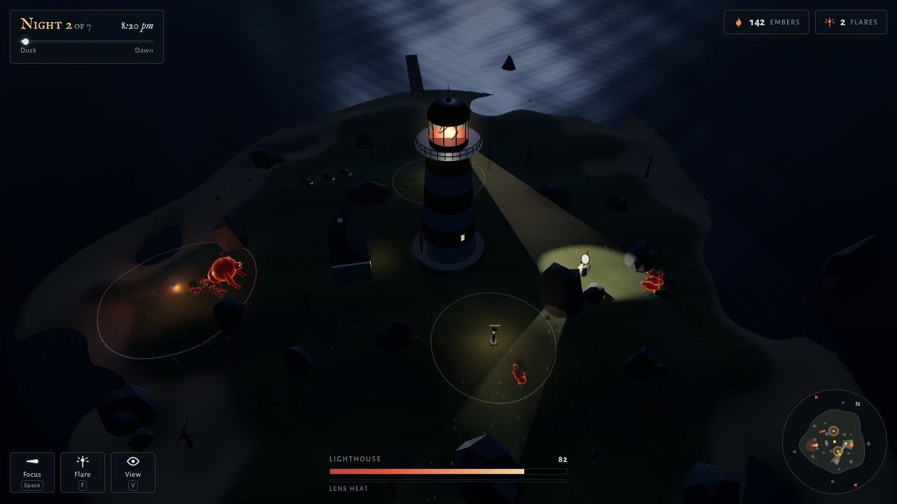
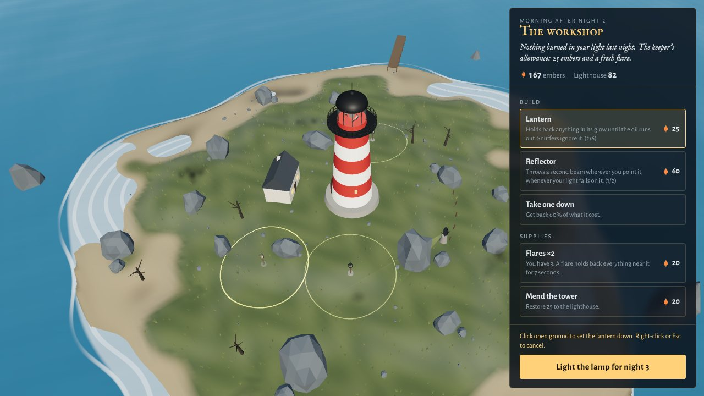

# Lighthouse

A 3D tower-defense game for the browser where your only weapon is the lighthouse's beam.
Things crawl out of the sea after dark, and **they can only move where your light is not**.
Keep the lamp burning for seven nights.

It's one HTML file with no install and no build step needed to play, and it runs with no
network connection.

**▶ [Play it here](https://dharoutounian.github.io/vigilant-fishstick/lighthouse/)** (live once this folder is on `main`)



---

## How it plays

You're the keeper, high in the lantern room. The lamp is mounted on a clockwork turntable,
so it swings toward wherever you point but only as fast as its gears allow.

- **Anything the beam touches freezes and starts to burn.** Hold it there and it burns away
  into embers that fly back to the lamp.
- **Focus** narrows the beam to half its width and burns 2.6× hotter, until the lens
  overheats and has to cool.
- **Shadows matter.** Rocks, the cottage and the big creatures all cast shadows from the
  lamp, and whatever is in shadow keeps moving. The shadows are computed from the same
  geometry the renderer draws, so if something looks dark, it is.
- **Range matters.** The light fades over the water. Things rising out of the sea can't be
  held until they wade into reach.
- Anything that reaches the foot of the tower claws at it, but only while it's in the dark.
- Survive until dawn and the rest burn away in the sunrise.

### What comes out of the water

| | |
|---|---|
| **Drowned** | The common crawler. |
| **Skitter** | Small and fast, and comes in packs. |
| **Hulk** | Slow and very hard to burn. Its bulk casts a shadow the small ones hide in. |
| **Snuffer** | Ignores lantern light and goes straight for your lanterns to put them out. |
| **Leviathan** | Comes on the last night and sheds skitters while it stays in the dark. |

Some nights bring a storm. Each lightning flash lights the whole island, and for that moment
nothing moves.

### The workshop

By day you spend embers:

| | |
|---|---|
| **Lantern** | Holds back anything in its glow until its oil runs out. |
| **Reflector** | Bounces a second beam in a direction you choose, but only while your lamp shines on it. |
| **Flares** | Thrown where you aim. They hold back everything nearby for seven seconds. |
| **Mend the tower** | Restores 25 to the lighthouse. |
| **Clockwork** | The lamp turns faster: 70 → 180 °/s. |
| **Fresnel prisms** | The beam burns hotter. |
| **Lens order** | A bigger lens and a wider beam, from fourth order up to first. |
| **Paraffin** | Lanterns burn longer. |

If the light goes out, you can try the same night again from that night's dusk. After the
seventh night you can keep watching for as long as you last.



## Controls

| Input | Action |
|---|---|
| Mouse | Aim the beam |
| `LMB` (hold) / `Space` | Focus the beam |
| `RMB` / `F` | Throw a flare where you aim |
| `Q` `E` / wheel | Turn and zoom the view |
| `V` | Keeper's view from the gallery (mouse or arrow keys to look) |
| `Esc` | Pause |
| Touch | Drag to aim; on-screen Focus, Flare and View buttons |

Pointer lock is optional. The keeper's view works without it, which matters inside embedded
or sandboxed frames.

## How it's built

`index.html` is generated. The source is ordered fragments in [`src/`](src/), concatenated
by [`build.py`](build.py), which also inlines three.js r128 from `node_modules`:

| File | Contents |
|---|---|
| `00_head.html` | HUD markup and all CSS |
| `10_core.js` | Helpers, tuning tables, procedural audio |
| `20_world.js` | Renderer, sky, sea shader, island terrain, props, the lighthouse |
| `30_light.js` | The beam, light tests and shadows, lanterns, reflectors, flares, lightning, particles |
| `40_monsters.js` | Creature models, behaviour, burning, embers |
| `50_workshop.js` | Daytime building and upgrades |
| `60_hud.js` | HUD, keeper's log, radar |
| `70_menu.js` | Title, settings, pause, end screens |
| `90_main.js` | The night cycle, input, camera, fixed-timestep loop |

```bash
npm install
python3 lighthouse/build.py
```

Everything is procedural: models, textures, the sea, and every sound is synthesized at
load time. There are no asset files. The simulation runs on a fixed 1/60 s step.

## Tests

The tests drive a real browser with Playwright.

```bash
npm run test:lighthouse
```

- `tests/rules.test.js` checks the rules directly: lit things freeze and burn at the stated
  rate, focus and overheating, rock and hulk shadows, lantern oil, snuffers, reflectors,
  flares, lightning, emerging creatures, damage at the door, and embers.
- `tests/flow.test.js` plays through the real interface with real mouse and keyboard input.
  It covers aiming, focusing, flares, the keeper's view with pointer lock refused, pausing,
  buying and placing in the workshop, the next night, losing, retrying and leaving.
- `tests/balance.test.js` has a bot keeper play whole games at accelerated speed. Leaving
  the beam still loses night 1, a steady keeper survives Calm seas, a sharp one survives
  the Squall, and a slow keeper who never focuses falls in the Tempest.

To watch the bot's numbers night by night, run `node lighthouse/tests/bot.js [difficulty 0-2] [nights]`.
It accepts `--human`, `--novice` or `--idle`.
